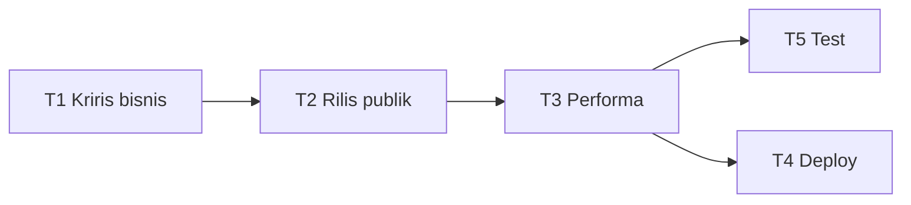

# HappyBouquet - Roadmap Perbaikan Pasca-Audit

| Proyek | HappyBouquet (happybouquet.web.id) |
|---|---|
| Versi | 0.1.0 (belum ditetapkan di package.json) |
| Tanggal | 2026-10-19 |
| Status | Draft |
| Sumber | Audit menyeluruh 2026-10-19; register: `docs/06-maintenance/register.md` |

## 1. Milestone (tahap pengerjaan)

| Tahap | Nama | Isi (BUG) | Target | Kriteria selesai |
|---|---|---|---|---|
| T1 | Kriris bisnis & kecil | BUG-0001, 0002, 0003, 0004, 0006 | 2026-10-19 | Checkout mengirim pesanan (atau WhatsApp), tidak ada harga coret palsu, cart awet di localStorage, rating determinis, GA tanpa debug |
| T2 | Keputusan rilis publik | BUG-0005, 0007, 0017, 0020 | 2026-10-19 | Maintenance OFF saat publik, data pribadi dihapus, secret wajib env, bypass tanpa query, badge DEV hanya di dev |
| T3 | Performa (app terasa berat) | BUG-0008, 0009, 0010, 0011, 0012, 0013, 0019 | 2026-10-19 | Detail produk SSR via useAsyncData (1 fetch), payload HTML ramping, related tanpa katalok penuh, hasil benchmark cache jelas, ikon server dikecilkan, swiper satu sumber, hero image berdimensi |
| T4 | Deploy & kebersihan | BUG-0014, 0015 | 2026-10-19 | Deploy hanya .output+package.json (tanpa root node_modules), file/deps mati terhapus |
| T5 | Pengamanan & test | BUG-0016, 0018 | 2026-10-19 | Test unit DP/total + cart reducer; wishlist aman hydration |

Urutan: T1 -> T2 -> T3 -> T4 -> T5. T4 bisa paralel dengan T3. T2 punya keputusan user dulu: situs mau publik atau tetap maintenance (BUG-0005).

## 2. Urutan pengerjaan dan ketergantungan

Checklist per tahap (jalankan berurutan, centang di sini atau di register):

**T1** — selesai 2026-10-19
- [x] BUG-0001: `placeOrder` kirim ringkasan pesanan via WhatsApp (wa.me); clearCart setelah kirim
- [x] BUG-0002: hapus baris `originalPrice` mock di index.vue, products/index.vue, useProducts.ts
- [x] BUG-0003: cart store -> `useLocalStorage('happybouquet-cart', [])` seperti wishlist
- [x] BUG-0004: hapus `Math.random()` rating (2 file)
- [x] BUG-0006: hapus `debug_mode: true`
- Verifikasi: `npm run build` lulus (L2; belum manual di browser)

**T2** — selesai 2026-10-19
- [x] Putuskan: publik (keputusan user 2026-10-19)
- [x] BUG-0005: buang `NUXT_MAINTENANCE_ENABLED=true` dari build rilis (deploy-local*.sh, deploy.yml, .env lokal)
- [x] BUG-0007: ganti isi user store dengan placeholder generik
- [x] BUG-0017: secret tanpa default + validasi; bypass via header `x-maintenance-secret`; regex ekstensi file
- [x] BUG-0020: TestingBadge bungkus `import.meta.dev`
- Verifikasi: `npm run build` lulus (L2). Catatan: bypass maintenance sekarang via header, bukan `?dev_mode=`

**T3** — selesai 2026-10-19
- [x] BUG-0008: halaman [slug] -> `useAsyncData` async composable; SSR penuh, 1 fetch
- [x] BUG-0009: home tampilkan 12 produk (katalog lengkap di /products)
- [x] BUG-0010: related dari cache SWR 15 mnt 'products-active-all' (shortcut: ganti ke endpoint API bila ada)
- [x] BUG-0011: keputusan user: cache Nitro TETAP Upstash (trade-off latensi diterima)
- [x] BUG-0012: `icon.serverBundle: 'remote'` -> icons.mjs 4.5MB hilang
- [x] BUG-0013: plugin global swiper.client.ts dihapus
- [x] BUG-0019: hero width/height + lazy slide non-pertama; FlashSaleSmall stok determinis (anti hydration mismatch)
- Verifikasi: build lulus; total 8.48MB -> 3.78MB; entry client 302KB -> 209KB (L2)

**T4** — selesai 2026-10-19
- [x] BUG-0014: deploy-local.sh + deploy-local-server.sh + deploy.yml buang npm ci/kirim root node_modules; hanya .output + package.json. deploy-local-cache.sh dipertahankan (kebutuhan user): npm ci lokal hanya bila package.json/lock berubah
- [x] BUG-0015: hapus 6 file mati + 5 dependensi (@nuxtjs/google-gtag, consola, @upstash/redis, unstorage, @iconify/utils)
- Verifikasi: bash -n kedua script; `npm run build` lulus setelah prune dependensi (L1)

**T5** — selesai 2026-10-19
- [x] BUG-0018: wishlist list + tombol heart ProductCard di `ClientOnly` (anti hydration mismatch)
- [x] BUG-0016: test unit vitest (`npm test`): payment summary DP (6) + cart reducer (6)
- Verifikasi: 12/12 test lulus; `npm run build` lulus (L2)

## 3. Rilis

| Versi | Tanggal | Isi |
|---|---|---|
| v0.2.0 | 2026-10-19 | T1+T2: checkout nyata, harga jujur, cart awet, rilis publik bersih |
| v0.3.0 | 2026-10-19 | T3+T4+T5: performa, deploy ringan, test unit, wishlist hydration aman |

## 4. Risiko jadwal (RISK-xx)

| ID | Risiko | Mitigasi |
|---|---|---|
| RISK-0001 | BUG-0001 butuh endpoint orders di backend (di luar repo ini) | Fallback sementara: kirim ringkasan pesanan ke WhatsApp |
| RISK-0002 | BUG-0009/0010 dapat menyentuh kontrak API backend | Koordinasi dulu; sementara cache di frontend |
| RISK-0003 | BUG-0011 perlu akses cek env + timing di server produksi | Ukur dari server via `time curl` sebelum ubah config |
