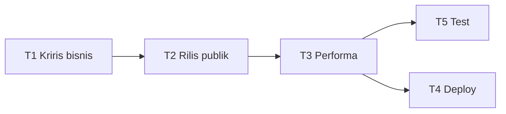

# HappyBouquet - Roadmap Perbaikan Pasca-Audit

| Proyek | HappyBouquet (happybouquet.web.id) |
|---|---|
| Versi | 0.1.0 (belum ditetapkan di package.json) |
| Tanggal | 2026-10-19 |
| Status | Draft |
| Sumber | Audit menyeluruh 2026-10-19; register: `docs/06-maintenance/register.md` |

## 1. Milestone (tahap pengerjaan)

| Tahap | Nama | Isi (BUG) | Target | Kriteria selesai |
|---|---|---|---|---|
| T1 | Kriris bisnis & kecil | BUG-0001, 0002, 0003, 0004, 0006 | 2026-10-19 | Checkout mengirim pesanan (atau WhatsApp), tidak ada harga coret palsu, cart awet di localStorage, rating determinis, GA tanpa debug |
| T2 | Keputusan rilis publik | BUG-0005, 0007, 0017, 0020 | 2026-10-19 | Maintenance OFF saat publik, data pribadi dihapus, secret wajib env, bypass tanpa query, badge DEV hanya di dev |
| T3 | Performa (app terasa berat) | BUG-0008, 0009, 0010, 0011, 0012, 0013, 0019 | 2026-10-19 | Detail produk SSR via useAsyncData (1 fetch), payload HTML ramping, related tanpa katalok penuh, hasil benchmark cache jelas, ikon server dikecilkan, swiper satu sumber, hero image berdimensi |
| T4 | Deploy & kebersihan | BUG-0014, 0015 | 2026-10-19 | Deploy hanya .output+package.json (tanpa root node_modules), file/deps mati terhapus |
| T5 | Pengamanan & test | BUG-0016, 0018 | 2026-10-19 | Test unit DP/total + cart reducer; wishlist aman hydration |
| T6 | Redesign home noir-gold | CR-0001 | 2026-10-19 | Home pakai design system "Aura Botanica Noir" (design/home/): font serif+body baru, section 1-9 sesuai mockup, FAQ baru, build lulus |
| T7 | Shell noir (header/footer) | CR-0002 | 2026-10-19 | Header, ticker, bottom bar, footer ikut tema noir-gold; halaman lain menyusul |
| T8 | Audit home/header/footer | BUG-0021 | 2026-10-19 | Fix tap target, kontras hero, font self-host, dokumen home-api |
| T9 | Penguatan Keamanan Frontend | BUG-0028..0032 | 2026-10-30 | Security headers global, cookie HMAC bypass, rel noopener, hapus dummy admin, dynamic key |
| T10 | Sync Promo & Auto Collect Analytics | CR-0004 | 2026-10-30 | Halaman /promo fetch API dinamis, plugin FE kirim data page view ke /api/analytics/collect |
| T11 | API Public Orders & Tracking | CR-0004 | 2026-10-30 | POST /api/orders/public & GET /api/orders/track/:orderNumber (rate-limited) di backend |
| T12 | FE Multi-Channel & Real-Time Tracking | CR-0004 | 2026-10-30 | Checkout FE integrasi auto-record & direct WA, halaman /tracking fetch API order riil |
| T13 | Panel Admin Real-Time SSE & Channel Filter | CR-0004 | 2026-10-30 | Panel menerima notifikasi live order baru dari web & filter channel penjualan |

Urutan: T1 -> T2 -> T3 -> T4 -> T5. T4 bisa paralel dengan T3. T2 punya keputusan user dulu: situs mau publik atau tetap maintenance (BUG-0005).

## 2. Urutan pengerjaan dan ketergantungan

Checklist per tahap (jalankan berurutan, centang di sini atau di register):

**T1** — selesai 2026-10-19
- [x] BUG-0001: `placeOrder` kirim ringkasan pesanan via WhatsApp (wa.me); clearCart setelah kirim
- [x] BUG-0002: hapus baris `originalPrice` mock di index.vue, products/index.vue, useProducts.ts
- [x] BUG-0003: cart store -> `useLocalStorage('happybouquet-cart', [])` seperti wishlist
- [x] BUG-0004: hapus `Math.random()` rating (2 file)
- [x] BUG-0006: hapus `debug_mode: true`
- Verifikasi: `npm run build` lulus (L2; belum manual di browser)

**T2** — selesai 2026-10-19
- [x] Putuskan: publik (keputusan user 2026-10-19)
- [x] BUG-0005: buang `NUXT_MAINTENANCE_ENABLED=true` dari build rilis (deploy-local*.sh, deploy.yml, .env lokal)
- [x] BUG-0007: ganti isi user store dengan placeholder generik
- [x] BUG-0017: secret tanpa default + validasi; bypass via header `x-maintenance-secret`; regex ekstensi file
- [x] BUG-0020: TestingBadge bungkus `import.meta.dev`
- Verifikasi: `npm run build` lulus (L2). Catatan: bypass maintenance sekarang via header, bukan `?dev_mode=`

**T3** — selesai 2026-10-19
- [x] BUG-0008: halaman [slug] -> `useAsyncData` async composable; SSR penuh, 1 fetch
- [x] BUG-0009: home tampilkan 12 produk (katalog lengkap di /products)
- [x] BUG-0010: related dari cache SWR 15 mnt 'products-active-all' (shortcut: ganti ke endpoint API bila ada)
- [x] BUG-0011: keputusan user: cache Nitro TETAP Upstash (trade-off latensi diterima)
- [x] BUG-0012: `icon.serverBundle: 'remote'` -> icons.mjs 4.5MB hilang
- [x] BUG-0013: plugin global swiper.client.ts dihapus
- [x] BUG-0019: hero width/height + lazy slide non-pertama; FlashSaleSmall stok determinis (anti hydration mismatch)
- Verifikasi: build lulus; total 8.48MB -> 3.78MB; entry client 302KB -> 209KB (L2)

**T4** — selesai 2026-10-19
- [x] BUG-0014: deploy-local.sh + deploy-local-server.sh + deploy.yml buang npm ci/kirim root node_modules; hanya .output + package.json. deploy-local-cache.sh dipertahankan (kebutuhan user): npm ci lokal hanya bila package.json/lock berubah
- [x] BUG-0015: hapus 6 file mati + 5 dependensi (@nuxtjs/google-gtag, consola, @upstash/redis, unstorage, @iconify/utils)
- Verifikasi: bash -n kedua script; `npm run build` lulus setelah prune dependensi (L1)

**T5** — selesai 2026-10-19
- [x] BUG-0018: wishlist list + tombol heart ProductCard di `ClientOnly` (anti hydration mismatch)
- [x] BUG-0016: test unit vitest (`npm test`): payment summary DP (6) + cart reducer (6)
- Verifikasi: 12/12 test lulus; `npm run build` lulus (L2)

**T6** — selesai 2026-10-19
- [x] F1: `@nuxtjs/google-fonts` (Plus Jakarta Sans, download:true; Playfair+Outfit sudah ada) + token noir-gold scoped `.noir-home` di main.css
- [x] F2: rewrite sections home mengikuti design/home/code.html:
  - [x] topbar promo strip (kode promo GOLDNOIR placeholder)
  - [x] restyle HeroSlider (340-380px, overlay noir, pill gold, dots+arrow gold)
  - [x] 4 value prop restyle (ph icons, hairline gold)
  - [x] flash sale panel noir-gold + 3 kartu + countdown (tetap; tanpa harga coret)
  - [x] kategori berfoto (foto produk per kategori, fallback emoji) — inline di index.vue
  - [x] bestseller grid 4 kolom + chip filter lokal + `ProductCardNoir` baru
  - [x] banner custom order restyle (WA + /contact)
  - [x] metrics strip + 3 kartu testimoni statis (tag + inisial)
  - [x] FAQ accordion baru (4 item, disesuaikan: Transfer/QRIS/COD)
- [x] F3: 4 komponen tak terpakai dihapus (QuickCategories, FlashSaleSmall, ProductCarousel, TestimonialSlider); `npm test` + `npm run build` lulus (total build 3.94MB — naik ~160KB = font self-host)
- Verifikasi: L1 build + test lulus; cek visual manual via `npm run dev` (belum dilakukan)

**T7** — selesai 2026-10-19
- [x] Token noir dipindah ke `:root`; tambah `.noir-shell` (bg/color/font) untuk header/footer
- [x] TickerBanner: noir + aksen gold (bukan gradient rose)
- [x] HeaderMain: logo/nav/search/actions/drawer mobile -> noir-gold
- [x] MobileBottomBar: aktif gold, CTA keranjang gold
- [x] FooterMain: noir #0a0a0a, heading label-crest, socials/newsletter gold
- [x] meta theme-color -> #D4AF37
- Verifikasi: `npm test` + `npm run build` lulus (L1); cek visual manual belum dilakukan. Catatan: CartModal/ProductVariantModal masih rose (menyusul)

**T8** — selesai 2026-10-19 (BUG-0021)
- [x] Helper noir pakai `:is(.noir-home, .noir-shell)` (btn-gold/btn-noir/noir-display/label-crest aktif di shell)
- [x] Footer: `/custom-order` -> `/contact`; param `?kategori=` -> `?cat=`; bottom bar `pb-24 md:pb-6`
- [x] FAQ: tambah class `group` di `
`; progress bar flash sale diberi aria-label
- [x] Header: scroll-lock body saat drawer mobile; tap target icon button 36 -> 40px
- [x] HeroSlider: counter hilangkan opasitas /60 (kontras)
- [x] Font: Playfair+Outfit self-host via @nuxtjs/google-fonts; hapus CDN import di main.css
- [x] index.vue: mapping produk duplikat -> pakai `mapProduct`; topbar text-xs -> text-sm
- [x] Dokumen kebutuhan API home: `docs/home-api-requirements.md`
- Verifikasi: `npm test` + `npm run build` lulus (L1)

**T9** — selesai 2026-10-30 (BUG-0028..0032)
- [x] BUG-0028: Tambah HTTP Security Headers global di `routeRules` (`X-Frame-Options: SAMEORIGIN`, `X-Content-Type-Options: nosniff`, `Referrer-Policy`, `Permissions-Policy`)
- [x] BUG-0029: Cookie bypass maintenance menggunakan HMAC SHA-256 token turunan (`httpOnly`, `sameSite: lax`, `secure: prod`)
- [x] BUG-0030: Reverse Tabnabbing fix: pasang `rel="noopener noreferrer"` pada semua tautan eksternal `target="_blank"` (FooterMain, ProductTrustPromise, contact, links, maintenance, index)
- [x] BUG-0031: Hapus file dummy `pages/admin/index.vue` dan tambahkan redirect 301 `/admin` -> `/` di `routeRules`
- [x] BUG-0032: Scoped dynamic key `product-detail-${id}` pada `useAsyncData` di `composables/useProductDetail.ts` untuk mencegah cache collision
- Verifikasi: `npm test` (12/12 lulus) + `npm run build` lulus (Nitro preset: node-server)

**T10** — Sync Promo & Auto Collect Analytics (CR-0004)
- [ ] Ubah `pages/promo.vue` agar memanggil API `${apiUrl}/promos?active=true` secara reaktif (hapus hardcoded promos)
- [ ] Buat/integrasikan plugin telemetri FE agar memanggil `POST /api/analytics/collect` pada event `page:finish`
- Verifikasi: `npm test` + `npm run build` lulus

**T11** — API Public Orders & Tracking (CR-0004)
- [ ] Buat endpoint `POST /api/orders/public` di `api-happyBouquet` (input order pelanggan dari web, generate order_number `HB-...`, channel `Web`)
- [ ] Buat endpoint `GET /api/orders/track/:orderNumber` di `api-happyBouquet` (rate-limited, public sanitized tracking data)
- Verifikasi: Test suite backend & unit test pass

**T12** — FE Multi-Channel & Real-Time Tracking (CR-0004)
- [ ] Modifikasi `pages/checkout/index.vue`: sebelum redirect ke WhatsApp, simpan order via `POST /api/orders/public`, sertakan nomor order resmi di teks WhatsApp & tampilkan confirmation modal/screen
- [ ] Modifikasi `pages/tracking.vue`: hubungkan input tracking ke `GET /api/orders/track/:orderNumber` dari database riil
- [ ] Tambahkan tombol alternatif channel (Chat WA / Shopee / TikTok) pada detail produk
- Verifikasi: `npm test` + `npm run build` lulus

**T13** — Panel Admin Real-Time SSE & Channel Filter (CR-0004)
- [ ] Pastikan event SSE `order:created` dari public web checkout memicu toast dan badge notifikasi di Panel Admin
- [ ] Filter order berdasarkan channel (`Web`, `WhatsApp`, `Shopee`, `TikTok`) di `OrderListView.vue`
- Verifikasi: Build Vite panel lulus

## 3. Rilis

| Versi | Tanggal | Isi |
|---|---|---|
| v0.2.0 | 2026-10-19 | T1+T2: checkout nyata, harga jujur, cart awet, rilis publik bersih |
| v0.3.0 | 2026-10-19 | T3+T4+T5: performa, deploy ringan, test unit, wishlist hydration aman |

## 4. Risiko jadwal (RISK-xx)

| ID | Risiko | Mitigasi |
|---|---|---|
| RISK-0001 | BUG-0001 butuh endpoint orders di backend (di luar repo ini) | Fallback sementara: kirim ringkasan pesanan ke WhatsApp |
| RISK-0002 | BUG-0009/0010 dapat menyentuh kontrak API backend | Koordinasi dulu; sementara cache di frontend |
| RISK-0003 | BUG-0011 perlu akses cek env + timing di server produksi | Ukur dari server via `time curl` sebelum ubah config |
